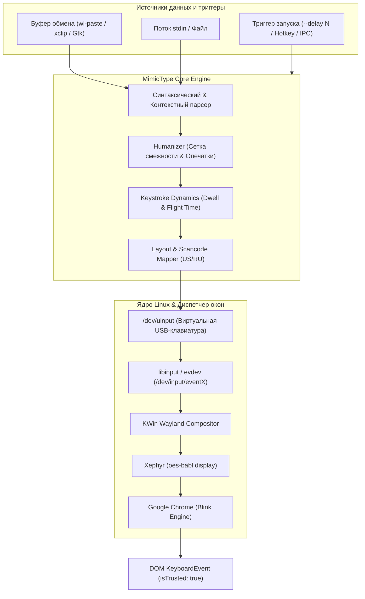
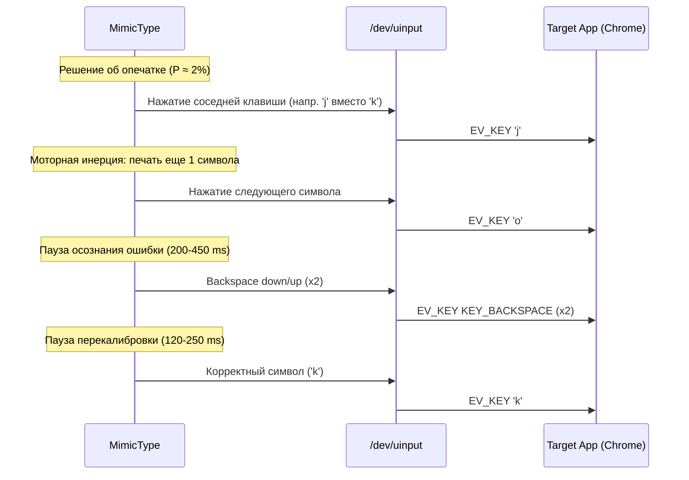

# Архитектурный план и спецификация: MimicType

**MimicType** — низкоуровневая утилита посимвольного ввода текста из буфера обмена для Linux, воспроизводящая биомеханическую динамику человеческой печати (Keystroke Dynamics) через виртуальное устройство ядра `/dev/uinput` (`evdev`).

---

## 1. Концепция и цели

1. **Естественная биомеханика набора (Keystroke Dynamics)**:
   - Моделирование времени удержания клавиш (*Dwell Time*) через логнормальное распределение.
   - Моделирование интервалов перехода (*Flight Time*) на основе физических расстояний между клавишами, диграфов (N-грамм), одноручных и разноручных переходов.
   - Контекстно-зависимый адаптивный ритм: когнитивные паузы перед знаками препинания, переводами строк и структурными элементами кода, эффект «пакетного» ускорения на знакомых словах.
2. **Имитация человеческого фактора**:
   - Реалистичные случайные опечатки на основе физической топологии клавиатурных раскладок (QWERTY / ЙЦУКЕН) — промах по соседней клавише («fat-finger»), инверсия символов (транспозиция).
   - Моделирование моторной инерции (ввод 1–2 последующих символов до момента обнаружения ошибки).
   - Когнитивная пауза осознания ошибки и серия быстрых ритмичных нажатий `Backspace` для самокоррекции.
3. **Низкоуровневая интеграция с Linux**:
   - Эмуляция аппаратного USB HID устройства через `/dev/uinput` (`python-evdev`).
   - События обрабатываются ядром Linux (`libinput`), композитором Wayland (KWin) и вложенными X-серверами (Xephyr в проекте `oes-babl`) как ввод с физической клавиатуры.
   - В браузере (Google Chrome / Firefox) события DOM `KeyboardEvent` формируются с флагом `event.isTrusted: true`, нативными кодами `code` (`"KeyA"`) и монотонными таймстампами.
4. **Сохранение фокуса**:
   - Отсутствие перехвата и переключения оконных фокусов (`XSetInputFocus`, `wmctrl`). Эмуляция на уровне ядра направляет поток ввода напрямую в активный элемент текущего окна.
5. **Безопасность и автономность**:
   - Работа от непривилегированного пользователя через настроенные права доступа к `/dev/uinput` (ACL / udev).
   - Наличие аварийного прерывателя (Kill Switch) по клавише `ESC` или хоткею.

---

## 2. Архитектура системы

---

## 3. Моделирование Keystroke Dynamics

### 3.1. Время удержания клавиши (Dwell Time)
Время между нажатием (`EV_KEY: 1`) и отпусканием (`EV_KEY: 0`).
Человеческий отклик подчиняется логнормальному распределению:
$$\ln(T_{\text{dwell}}) \sim \mathcal{N}(\mu, \sigma^2) \implies T_{\text{dwell}} = \exp(\mu + \sigma \cdot Z), \quad Z \sim \mathcal{N}(0, 1)$$
- Параметры: $\mu \approx 4.31$ (медиана ~74 мс), $\sigma \approx 0.20$.
- Границы отсечения: $[45\text{ ms}, 145\text{ ms}]$.
- Модификаторы (`Shift`):
  - Опережение нажатия `KEY_LEFTSHIFT` перед символом: $35\text{--}80\text{ ms}$.
  - Задержка удержания после отпускания символа: $25\text{--}60\text{ ms}$.

### 3.2. Время перехода (Flight Time) и биомеханика диграфов
Время между отпусканием клавиши $i$ и нажатием клавиши $i+1$. Вычисляется на основе евклидова/манхэттенского расстояния между координатами клавиш $(r_1, c_1)$ и $(r_2, c_2)$ на физической клавиатуре:
1. **Разноручный переход (Alternate-hand)**:
   - Пальцы противоположной руки заранее готовятся к нажатию. Задержка минимальна: $30\text{--}75\text{ ms}$.
2. **Одноручный разнопальцевый переход (Same-hand, different fingers)**:
   - Средняя задержка: $75\text{--}140\text{ ms}$.
3. **Одноручный однопальцевый переход (Same-finger)**:
   - Требуется физическое перемещение пальца по рядам: $140\text{--}230\text{ ms}$.
4. **Повтор одной клавиши (Double-tap)**:
   - Полное отпускание и повторное нажатие той же клавиши: $95\text{--}160\text{ ms}$.

### 3.3. Контекстный ритм
- **Знаки препинания** (`.`, `!`, `?`): когнитивная пауза $300\text{--}700\text{ ms}$.
- **Запятые и разделения** (`,`, `;`, `:`): микропауза $180\text{--}380\text{ ms}$.
- **Перевод строки (`\n`)**: пауза перехода к новой строке/мысли $400\text{--}1100\text{ ms}$.
- **Синтаксис кода** (`def `, `class `, `if `, `{`, `}`): пауза обдумывания блока с последующим быстрым вводом ключевого слова («пакетный» ввод).
- **Отступы (пробелы/табуляции)**: ритмичный ввод с низким джиттером ($35\text{--}60\text{ ms}$).

---

## 4. Имитация человеческих опечаток и исправления

1. **Топологический граф смежности клавиш**:
   - Матрица физического расположения клавиш (ряды 0..3, колонки 0..12).
   - Опечатка выбирается исключительно из множества геометрически смежных клавиш.
2. **Инверсия символов (Транспозиция)**:
   - Около 15% опечаток представляют собой перестановку двух последовательных букв (напр. `teh` вместо `the`).
3. **Инерция и откат**:
   - Ошибка обнаруживается не мгновенно, а спустя 0–2 последующих нажатия.
   - После паузы осознания генерируется серия нажатий `KEY_BACKSPACE` с характерным быстрым ритмом ($T_{\text{dwell}} \approx 45\text{ ms}$, $T_{\text{flight}} \approx 65\text{ ms}$).

---

## 5. Низкоуровневая интеграция: Linux uinput & Scancodes

1. **Регистрация устройства**:
   - `UInput` устройство регистрируется с шиной `BUS_USB`, реальными Vendor ID (`0x046d` Logitech) и Product ID (`0xc31c`).
   - Объявляются возможности: `EV_KEY` (набор клавиш от `KEY_ESC` до `KEY_RIGHTALT`), `EV_SYN` (`SYN_REPORT`).
2. **Трансляция Unicode $\to$ Scancodes**:
   - Поддержка двухслойной трансляции для двух алфавитов:
     - Латиница: US QWERTY.
     - Кириллица: RU ЙЦУКЕН.
   - Управление состоянием модификаторов (`KEY_LEFTSHIFT`).
   - Автоматическая посылка хоткея смены раскладки (по умолчанию `Alt+Shift`) при смене алфавита в потоке текста.
3. **Подтверждение `event.isTrusted: true`**:
   - События поступают из системного драйвера ввода Linux ядра. Для Chromium/Blink они неотличимы от физического ввода с аппаратной USB-клавиатуры.

---

## 6. Модульная структура

- `mimictype/cli.py` — консольный интерфейс (параметры, задержка, WPM, уровень опечаток).
- `mimictype/config.py` — загрузка настроек (YAML / dataclass).
- `mimictype/core/device.py` — управление виртуальным `UInput` устройством.
- `mimictype/core/dynamics.py` — генератор таймингов (Dwell/Flight, логнормальные формулы).
- `mimictype/core/topology.py` — физические координаты клавиш и расчет расстояний.
- `mimictype/core/humanizer.py` — генератор опечаток, инверсий и цепочек Backspace.
- `mimictype/core/mapper.py` — сопоставление символов с `ecodes.KEY_*` и модификаторами.
- `mimictype/core/clipboard.py` — модульный считыватель буфера обмена (Wayland/X11).
- `mimictype/core/engine.py` — главный координатор процессов печати и аварийного прерывания.

---

## 7. Этапы разработки и тестирования

| Этап | Задачи | Критерий приемки |
|------|--------|-------------------|
| **1. Архитектурный каркас** | Инициализация Git-репозитория, документации, структуры модулей, `pyproject.toml` | Структура создана, тесты импортов проходят |
| **2. Виртуальное устройство и верификация** | Реализация `UInputDevice`, тестовая HTML-страница | В Chrome фиксируется `event.isTrusted: true` |
| **3. Транслятор раскладок** | Маппер Unicode $\to$ Scancodes для US/RU и спецсимволов | 100% корректный ввод текстового алфавита |
| **4. Движок Keystroke Dynamics** | Логнормальный dwell, расчет диграфов и ритма | Статистическое распределение интервалов соответствует живому человеку |
| **5. Имитация опечаток** | Граф смежности, транспозиция, цепочка Backspace | Реалистичные ошибки с мгновенным автоматическим исправлением |
| **6. Интеграция и CLI** | Поддержка буфера обмена (`wl-paste`, `xclip`), таймеры, Kill-switch | Готовая к установке утилита с автодополнением и флагами |
